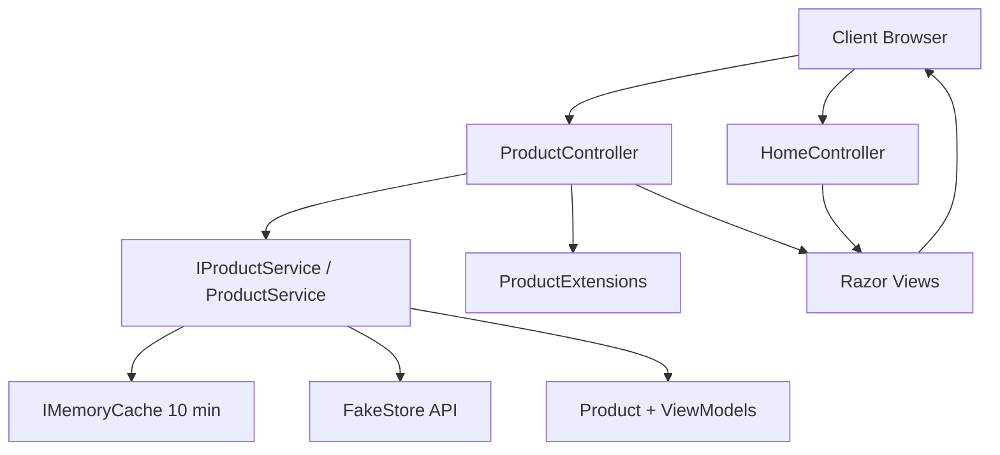
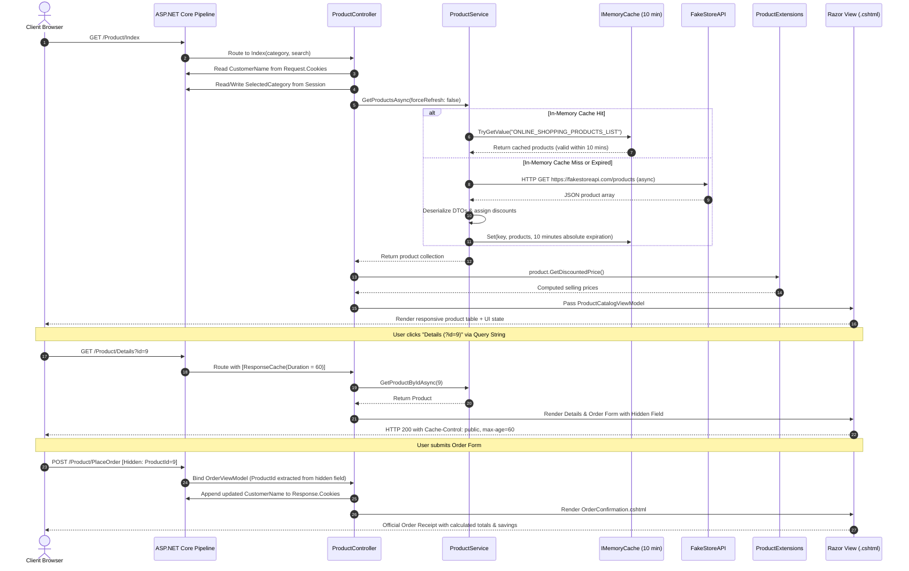

# 🛍️ Online Shopping Product Management System

An enterprise-grade, fully functional **ASP.NET Core MVC** web application developed to display products, calculate discounted selling prices via extension methods, manage customer state across multiple mechanisms, and optimize performance through multi-tier caching.

---

## 📋 Table of Contents
1. [Project Overview](#-project-overview)
2. [Architectural Overview & Flow Diagram](#-architectural-overview--flow-diagram)
3. [Implementation of Core Requirements](#-implementation-of-core-requirements)
   - [1. Model and Extension Method](#1-model-and-extension-method)
   - [2. Asynchronous Web Request](#2-asynchronous-web-request)
   - [3. State Management (Cookie, Session, Query String, Hidden Field)](#3-state-management)
   - [4. Caching (Response Cache & IMemoryCache)](#4-caching)
4. [Project Directory Structure](#-project-directory-structure)
5. [In-Line Code Documentation Standards](#-in-line-code-documentation-standards)
6. [How to Run Locally](#-how-to-run-locally)
7. [Educational Submission Notes](#-educational-submission-notes)

---

## 🌟 Project Overview

The **Online Shopping Product Management System** is built with ASP.NET Core MVC (.NET 10). It provides an interactive e-commerce product catalog with dynamic discount pricing, stateful browsing, and fast caching.

### Key Highlights
- **Architecture**: Clean 3-Tier Model-View-Controller (MVC) with dedicated Service and Extension layers.
- **Modern UI**: Styled with Bootstrap 5, custom CSS design system, micro-animations, glassmorphic cards, responsive table and card grid switchers.
- **Resilience**: Asynchronous HTTP client to `https://fakestoreapi.com/products` with automatic fallback catalog if external APIs encounter latency.
- **Educational Excellence**: 100% of methods, statements, models, and configuration lines contain comprehensive explanatory comments.

---

## 🏗️ Architectural Overview & Flow Diagram

### High-Level 3-Tier MVC Architecture (Mermaid)



### Complete End-to-End Request Flow Diagram (Mermaid)



---

## 🎯 Implementation of Core Requirements

### 1. Model and Extension Method
- **`Product` Model** (`Models/Product.cs`):
  Contains all required fields: `ProductId`, `ProductName`, `Category`, `Price`, and `DiscountPercentage`, complemented by `Description`, `Image`, `RatingRate`, and `RatingCount`.
- **Extension Method `GetDiscountedPrice()`** (`Extensions/ProductExtensions.cs`):
  Implemented as a static extension on `Product`:
  $$\text{Selling Price} = \text{Original Price} - \left(\text{Original Price} \times \frac{\text{Discount Percentage}}{100}\right)$$
  Also includes `GetSavingsAmount()` and `HasDiscount()`.
- **Display**: Shown prominently on both the Product Catalog table and the Product Details page with strike-through original prices and highlighted discounted values.

```csharp
// Definition in Extensions/ProductExtensions.cs
public static decimal GetDiscountedPrice(this Product product)
{
    if (product == null) return 0.0m;
    if (product.DiscountPercentage <= 0.0m) return product.Price;
    decimal discountDeduction = product.Price * (product.DiscountPercentage / 100.0m);
    decimal sellingPrice = product.Price - discountDeduction;
    return Math.Round(Math.Max(sellingPrice, 0.0m), 2, MidpointRounding.AwayFromZero);
}
```

---

### 2. Asynchronous Web Request
- **Endpoint**: `https://fakestoreapi.com/products`
- **Asynchronous Retrieval** (`Services/ProductService.cs`):
  Invoked via `HttpClient.GetFromJsonAsync<List<FakeStoreProductDto>>()`.
- **UI Table Display** (`Views/Product/Index.cshtml`):
  Presents Product Title, Price, Category, Discount %, and Discounted Price in a responsive HTML5 table with sorting, category chips, search, and table-to-card toggle.
- **Graceful Resilience**: Includes an integrated fallback dataset in case FakeStoreAPI experiences internet connectivity interruptions.

---

### 3. State Management

The application demonstrates all four core state management techniques required:

| State Technique | Requirement Goal | How It Is Implemented |
|---|---|---|
| **1. Cookie** | Store Customer Name | `Response.Cookies.Append("CustomerName", name, options)` with 7-day expiration. Greeting displayed in navbar banner and pre-filled in order forms. |
| **2. Session** | Store Selected Product Category | `HttpContext.Session.SetString("SelectedCategory", category)` when filtering by category chips. Persists filter across user navigation. |
| **3. Query String** | Pass `ProductId` to Details Page | Link format: `/Product/Details?id=9`. Controller binds `[FromQuery] int? id` and validates `Request.Query["id"]`. |
| **4. Hidden Field** | Submit `ProductId` with Order Form | Rendered in form: `<input type="hidden" name="ProductId" value="@Model.ProductId" />`. Bound on POST to `OrderViewModel.ProductId`. |

---

### 4. Caching

| Caching Mechanism | Requirement Goal | Technical Configuration |
|---|---|---|
| **Response Caching** | Cache Product Details Page | Decorated with `[ResponseCache(Duration = 60, Location = ResponseCacheLocation.Any, VaryByQueryKeys = new[] { "id" })]`. Enabled via `app.UseResponseCaching()`. |
| **Memory Caching (`IMemoryCache`)** | Cache Product List with 10-Min Expiration | Injected into `ProductService`. Configured via `options.SetAbsoluteExpiration(TimeSpan.FromMinutes(10))`. Manual "Refresh Cache" button available in UI for testing. |

---

## 📂 Project Directory Structure

```
cie-2/
├── Controllers/
│   ├── HomeController.cs                # Entry landing, live dashboard & architecture page
│   └── ProductController.cs             # Catalog, Details, Order placement & State actions
├── Extensions/
│   └── ProductExtensions.cs             # Extension method: GetDiscountedPrice() & GetSavingsAmount()
├── Models/
│   ├── Product.cs                       # Core product domain model
│   ├── FakeStoreProductDto.cs           # DTO for FakeStoreAPI JSON response
│   ├── ProductCatalogViewModel.cs       # Composite model for catalog table & state
│   ├── OrderViewModel.cs                # Order submission model with Hidden Field ProductId
│   └── ErrorViewModel.cs                # Diagnostics model
├── Services/
│   ├── IProductService.cs               # Service contract
│   └── ProductService.cs                # Async API requests, IMemoryCache (10 min) & fallback data
├── Views/
│   ├── Home/
│   │   ├── Index.cshtml                 # Interactive dashboard & live state monitor
│   │   ├── Architecture.cshtml          # Flow diagrams & layer specifications
│   │   └── Privacy.cshtml
│   ├── Product/
│   │   ├── Index.cshtml                 # Table view of products from FakeStoreAPI
│   │   ├── Details.cshtml               # Product specs, Query String info & Hidden Field Form
│   │   ├── OrderConfirmation.cshtml     # Receipt verifying Hidden Field ProductId submission
│   │   └── ErrorDetails.cshtml          # Query string error view
│   ├── Shared/
│   │   ├── _Layout.cshtml               # Master navbar, Cookie modal, Session badge & Footer
│   │   └── _ValidationScriptsPartial.cshtml
│   ├── _ViewImports.cshtml              # Global namespace & tag helpers
│   └── _ViewStart.cshtml
├── wwwroot/
│   ├── css/site.css                     # Custom glassmorphic styles, badges & table aesthetics
│   └── js/site.js                       # Client-side table/grid switcher & tooltips
├── Dockerfile                           # Multi-stage container deployment
├── .dockerignore
├── OnlineShoppingSystem.csproj          # .NET 10 project file
├── Program.cs                           # DI registration (Session, Cache, HttpClient) & Middleware
└── README.md                            # Comprehensive project & architecture documentation
```

---

## 📝 In-Line Code Documentation Standards

Every C# class, property, extension method, Razor view, and configuration block includes line-by-line comments describing:
- **Purpose**: Why the code exists.
- **Logic**: How variables, calculations, and algorithms operate.
- **ASP.NET Core Concepts**: Explaining Dependency Injection, Session Middleware, Response Cache directives, Cookie attributes, and LINQ operations.

---

## 🚀 How to Run Locally

### Prerequisites
- [.NET 10 SDK or .NET 8/9 SDK](https://dotnet.microsoft.com/download)

### Steps
1. Open terminal in the project directory:
   ```bash
   cd c:\Users\MAX\OneDrive\Desktop\cie-2
   ```
2. Restore dependencies:
   ```bash
   dotnet restore
   ```
3. Build the solution:
   ```bash
   dotnet build
   ```
4. Run the application:
   ```bash
   dotnet run
   ```
5. Open your browser and navigate to:
   ```
   http://localhost:5241
   ```


## 👥 Educational Submission Notes
This project was designed and built to fulfill all curriculum guidelines for the Online Shopping Product Management System, with full compliance across:
1. **Model & Extension Method** (`Product`, `GetDiscountedPrice()`)
2. **Asynchronous Web Requests** (`FakeStoreAPI`, `HttpClient`)
3. **State Management** (`Cookies`, `Session`, `Query String`, `Hidden Field`)
4. **Caching** (`IMemoryCache` 10-minute expiry, `Response Caching`)
5. **Comprehensive Line-by-Line Student Explanatory Comments**
